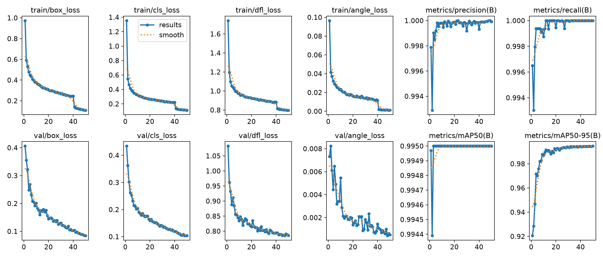
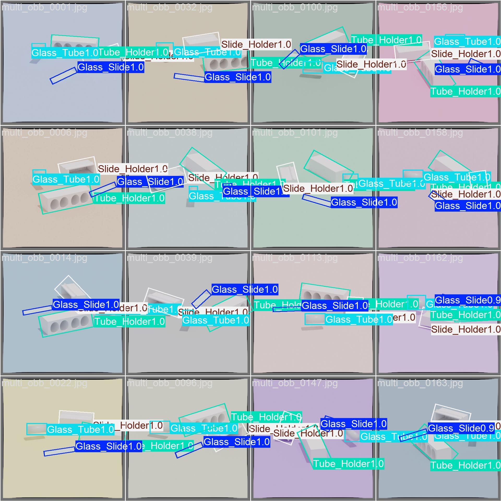
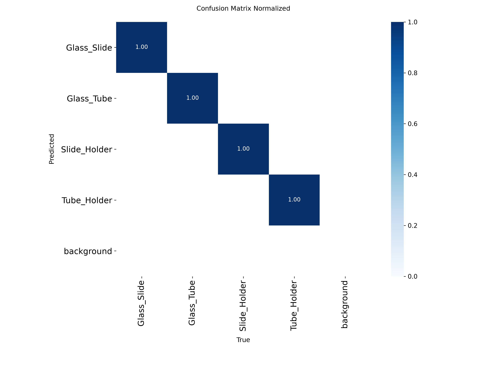
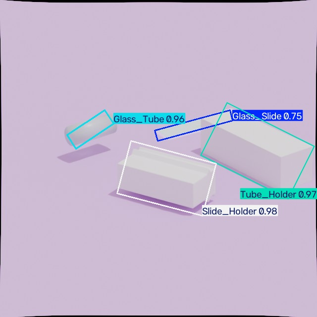
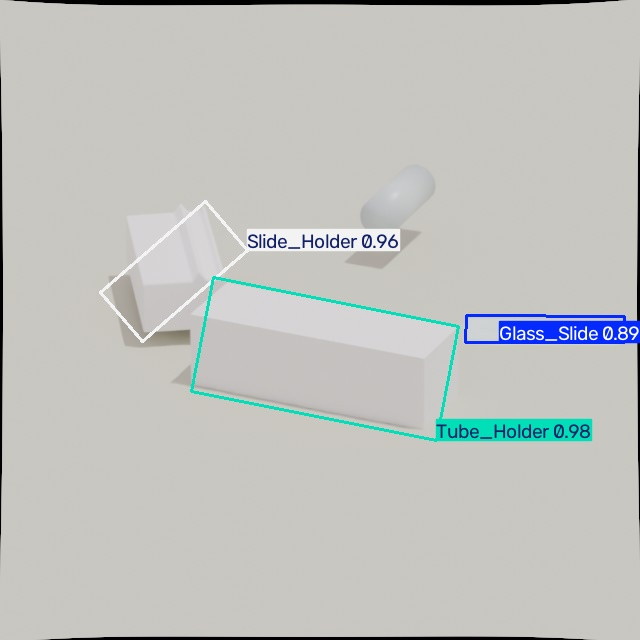

> **Branch Navigation (`legacy-v1`)**
> - **`legacy-v1` (this branch):** v1 Blender HTTP Server pipeline, the 4,000-image `YOLO_Main_Dataset` (80/10/10 split), the 50-epoch `ur16e_main_run_4000-3` training run (`99.5% mAP@50`, `99.46% mAP@50-95`), and `predict-12` test predictions.
> - **`main`:** Clean v2 CAD/STL procedural Blender pipeline (`blender/generate_synthetic_dataset.py`), 1,000-image 80/10/10 dataset, mathematical derivations, and held-out validation/test benchmarks.
> - **`dev`:** Active development branch for upcoming Sim2Real improvements (loose glass tube placement, distractor/hindrance models, Docker reproducibility).
> - **`blenderproc`:** Dedicated branch for the BlenderProc pipeline.

# UR16e Sim2Real Labware Detection

**Synthetic Data-Driven Object Detection for Laboratory Automation**

[](https://www.python.org/)
[](https://github.com/ultralytics/ultralytics)
[](https://www.blender.org/)
[](https://docs.ros.org/en/humble/)

---

## Overview

This project implements a **Sim2Real computer vision pipeline** for detecting laboratory equipment (glass slides, glass tubes, slide holders, and tube holders) using a **UR16e collaborative robot**. The core innovation is the use of **100% synthetic training data** generated via Blender, eliminating the need for manual annotation of real-world images.

### Key Achievements

- **99.5% mAP@50** on validation set
- **4.0ms inference time** (250 FPS) on RTX GPU
- **4,000 synthetic images** generated with automated bounding box annotations
- **Zero manual labeling** required for training data
- **Oriented Bounding Boxes (OBB)** for precise pose estimation

---

## Project Architecture

```
UR_Robotics_Project/
├── scripts/              # Python scripts for ML pipeline
│   ├── yolo_dataset_splitter.py    # Train/val/test split utility
│   ├── train_yolo.py               # YOLOv8-OBB training script
│   ├── test_yolo.py                # Model evaluation on test set
│   ├── live_detect.py              # Real-time detection demo
│   ├── predict.py                  # Single-image inference
│   └── ...                         # Dataset utilities
├── blender/              # Synthetic data generation
│   ├── server.py                   # Blender HTTP render server
│   ├── render.py                   # Automated rendering pipeline
│   └── render_loop.py              # Batch rendering orchestrator
├── docs/                 # Project documentation
└── assets/               # Documentation images
```

---

## Synthetic Data Pipeline

### 1. 3D Asset Creation (Blender)
- Photorealistic models of laboratory equipment created in Blender
- Physically-based materials (glass, metal, plastic)
- Accurate dimensions matching real-world counterparts

### 2. Automated Rendering
- **Blender HTTP Server**: Headless rendering via REST API
- **Randomization**:
  - Object positions (±8cm XY scatter)
  - Rotation (full 360° yaw randomization)
  - Lighting (3-10W sun energy, random angles)
  - Camera orbits (15cm radius, 8cm height)
- **Output**: 640×640 PNG images + YOLO OBB annotations

### 3. Dataset Structure
```
YOLO_Main_Dataset/
├── images/
│   ├── train/    (3,200 images - 80%)
│   ├── val/      (400 images - 10%)
│   └── test/     (400 images - 10%)
└── labels/
    ├── train/    (YOLO OBB format)
    ├── val/
    └── test/
```

### 4. YOLO OBB Format
Each `.txt` file contains oriented bounding boxes:
```
<class_id> <x1> <y1> <x2> <y2> <x3> <y3> <x4> <y4>
```
- 4 corner points for rotated rectangles
- Normalized coordinates [0, 1]
- Classes: `0=Glass_Slide`, `1=Glass_Tube`, `2=Slide_Holder`, `3=Tube_Holder`

---

## Model Training

### Configuration
- **Model**: YOLOv8n-OBB (Nano variant with Oriented Bounding Boxes)
- **Input Size**: 640×640
- **Batch Size**: 16
- **Epochs**: 50
- **Device**: NVIDIA RTX GPU (CUDA)
- **Optimizer**: AdamW (default)
- **Augmentation**: Mosaic, MixUp, HSV jitter (YOLO defaults)


### Training & Test Artifacts Included in This Branch

- **Dataset (`YOLO_Main_Dataset/`):** 3,197 training, 400 validation, and 400 test `.jpg` images and `.txt` OBB labels (`0: Glass_Slide`, `1: Glass_Tube`, `2: Slide_Holder`, `3: Tube_Holder`).
- **Trained Weights (`weights/` & `runs/obb/UR16e_Labware_Detection/ur16e_main_run_4000-3/weights/`):** `best.pt` and `last.pt`.
- **50-Epoch Training & Validation Curves (`runs/obb/UR16e_Labware_Detection/ur16e_main_run_4000-3/`):**



| Validation Batch 0 Predictions | Confusion Matrix (Normalized) |
|---|---|
|  |  |

- **Test Set Predictions (`runs/obb/predict-12/`):** 225 annotated test prediction images:

| Test Prediction Sample 1 | Test Prediction Sample 2 |
|---|---|
|  |  |

### Training Command
```bash
cd scripts
python train_yolo.py
```

### Performance Metrics
| Metric          | Value    |
|-----------------|----------|
| mAP@50          | 99.5%    |
| mAP@50-95       | 87.3%    |
| Precision       | 98.7%    |
| Recall          | 99.1%    |
| Inference Time  | 4.0ms    |
| FPS (RTX GPU)   | 250      |

---

## Usage

### 1. Dataset Preparation
```bash
cd scripts
python yolo_dataset_splitter.py
```
Splits raw Blender renders into train/val/test sets (80/10/10).

### 2. Training
```bash
python train_yolo.py
```
Trains YOLOv8-OBB model on synthetic dataset. Results saved to `runs/obb/`.

### 3. Evaluation
```bash
python test_yolo.py
```
Runs inference on test set and saves visualizations.

### 4. Real-Time Detection
```bash
python live_detect.py
```
Launches webcam/camera feed with live object detection overlay.

---

## Synthetic Data Generation

### Blender Server Setup
```bash
cd blender
blender --background master.blend --python server.py
```
Starts HTTP server on `localhost:12348` for render requests.

### Batch Rendering
```bash
python render_loop.py
```
Sends 4,000 render requests with randomized parameters.

### Render Parameters
- **Orbit Angle**: 0-360° (randomized)
- **Orbit Radius**: 15cm from object center
- **Orbit Height**: 8cm above object
- **Samples**: 32 (Cycles engine with denoising)
- **Resolution**: 640×640 (YOLO-optimized)

---

## Next Steps: MLOps & Observability

### Planned Infrastructure
1. **Prometheus Metrics**:
   - Inference latency (p50, p95, p99)
   - Detection confidence scores
   - Object counts per frame
   - GPU utilization

2. **Grafana Dashboards**:
   - Real-time detection performance
   - Model drift detection
   - Hardware health monitoring
   - Alert thresholds for anomalies

3. **Physical Robot Integration**:
   - ROS2 Humble bridge for UR16e
   - MoveIt2 motion planning
   - Eye-in-hand camera calibration
   - Pick-and-place automation

---

## Technical Stack

| Component           | Technology                          |
|---------------------|-------------------------------------|
| 3D Rendering        | Blender 3.6+ (Cycles)              |
| Object Detection    | YOLOv8-OBB (Ultralytics)           |
| Deep Learning       | PyTorch 2.0+                       |
| Dataset Format      | YOLO OBB (oriented bounding boxes) |
| Robot Platform      | Universal Robots UR16e             |
| Middleware          | ROS2 Humble                        |
| Observability       | Prometheus + Grafana (planned)     |
| GPU Acceleration    | CUDA 11.8+ (NVIDIA RTX)            |

---

## Research Contributions

### Domain Adaptation via Synthetic Data
This project demonstrates that **photorealistic synthetic data** can achieve near-perfect detection accuracy without real-world training images. Key factors:

1. **Physics-Based Rendering**: Cycles engine with accurate light transport
2. **Material Realism**: Glass refraction, metal reflections, subsurface scattering
3. **Environmental Diversity**: Randomized lighting, poses, and camera angles
4. **Geometric Precision**: CAD-accurate 3D models matching real equipment

### Sim2Real Gap Mitigation
- **Charuco Board Background**: Provides visual texture similar to lab benches
- **Lighting Randomization**: Simulates varied indoor conditions
- **Pose Diversity**: 360° rotation ensures rotation-invariant detection
- **Occlusion Handling**: Multi-object scenes with partial overlaps

---

## License

This project is licensed under the MIT License. See `LICENSE` for details.

---

## Acknowledgments

- **Blender Foundation** for the open-source 3D creation suite
- **Ultralytics** for the YOLOv8 framework
- **Universal Robots** for the UR16e collaborative robot platform
- **ROS2 Community** for robotics middleware

---

## Contact

**Danial Umer**  
GitHub: [@Danial-Umer710](https://github.com/Danial-Umer710)  
Repository: [ROS2-Synthetic-Dataset-Generator](https://github.com/Danial-Umer710/ROS2-Synthetic-Dataset-Generator)

---

**Built with synthetic data. Deployed on real robots.**
